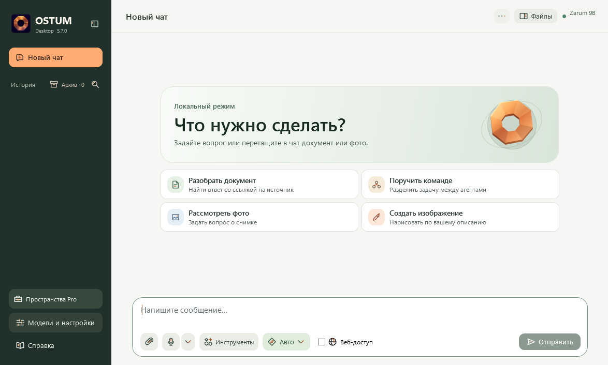
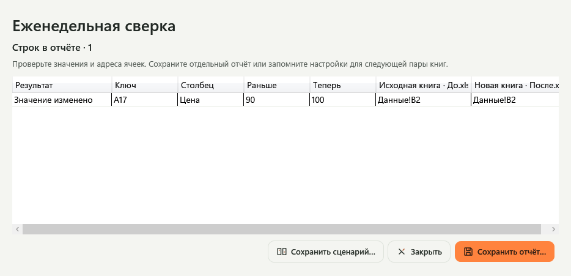
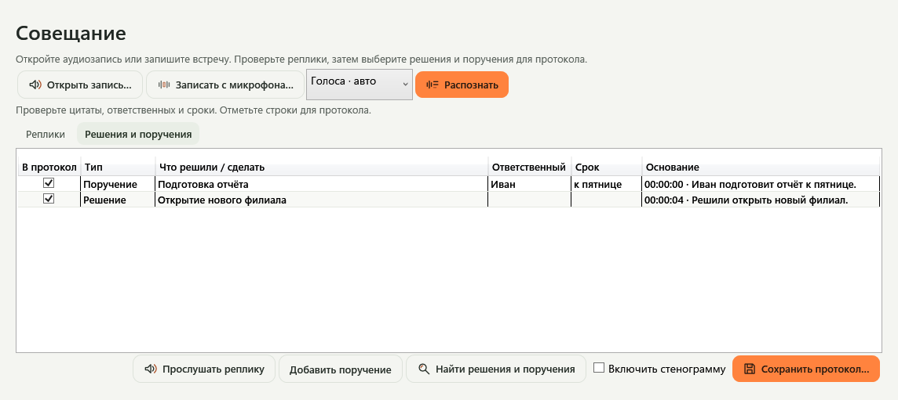
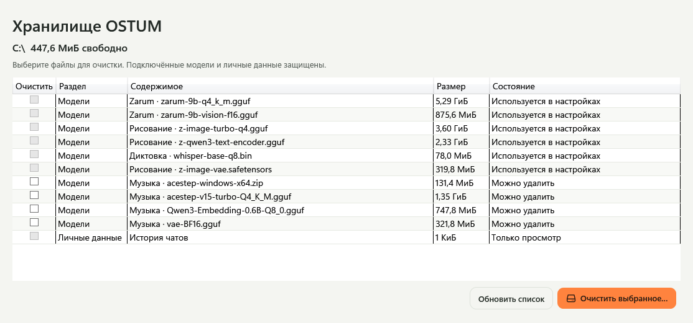
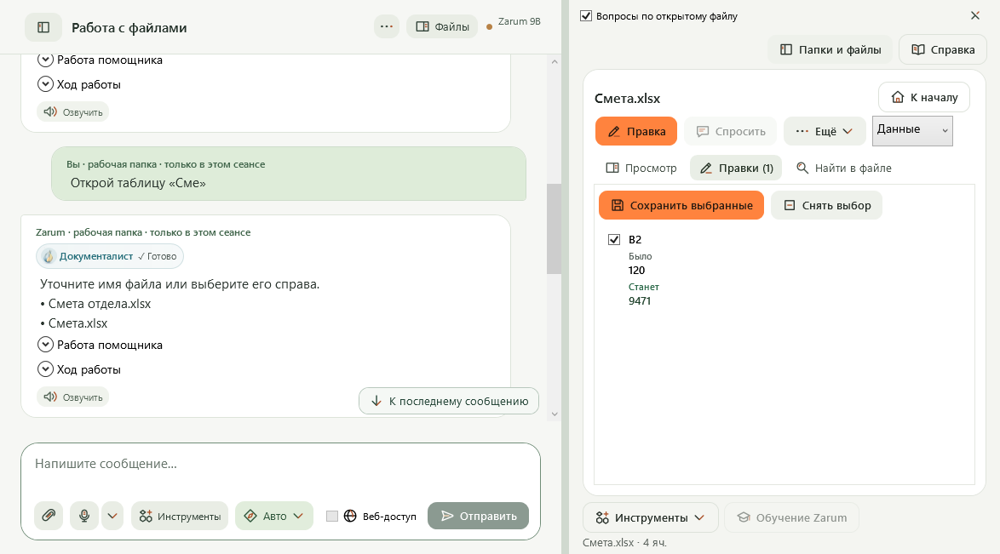

# OSTUM Desktop — offline AI assistant for Windows

[Doomsday AI — the offline USB field guide](https://ranis2023.github.io/ostum-desktop/en/doomsday-ai/) · [Читать статью на русском](https://ranis2023.github.io/ostum-desktop/doomsday-ai/)

[Русский README](README.md) · [Download for Windows x64](https://github.com/Ranis2023/ostum-desktop/releases/latest/download/Ostum-Desktop-Setup.exe) · [Releases and SHA-256 checksums](https://github.com/Ranis2023/ostum-desktop/releases)

[Project site and walkthroughs](https://ranis2023.github.io/ostum-desktop/en/) · [Try the Excel example with two sample workbooks](https://ranis2023.github.io/ostum-desktop/en/excel/) · [Project discussions](https://github.com/Ranis2023/ostum-desktop/discussions)

OSTUM runs **Zarum 9B**, a local model based on Qwen3.5-9B, on your own PC. Chat, photo analysis, document reading, dictation and image generation keep working when the network goes down. The interface and built-in help are in Russian.



## New in 5.7

| What you can do | How to try it |
| --- | --- |
| Find an exact message | Press **Ctrl+Shift+F**, enter words from the conversation and open a result. You can filter by project or include archived chats. Search uses saved messages on this PC. |
| Repeat an Excel comparison in Pro | Select two workbooks, choose a sheet and key column on each side, then review changes with the original cell addresses. Save a separate XLSX report or name the workflow to reuse it with the next pair of files. |
| Turn a meeting into minutes | Open **Инструменты → Совещание**. Import a recording or record a microphone, transcribe it locally with Whisper, then ask the local model to find decisions and actions. Listen at a timestamp, correct the speaker names, and select the rows to export as text. Speaker grouping on a single audio channel is approximate. |
| Manage local storage | Open **Модели и настройки → Место на диске** to see free space and the size of individual components. Review and confirm selected caches and inactive modules before removal. Chats, active models and imported GGUF files are protected. Managed workstations have a read-only view. |

<details>
<summary>View the four features with sample data</summary>








</details>

This update also brings changes since the 5.4 public release. Version 5.5 added offline OCR for scanned PDFs, invoice review with duplicate detection, spreadsheet range calculations and task calendar exports. Version 5.6 added a local conversation index, faster repeat reads of Office files and improved navigation in long chats. [5.5 changes in Russian](packaging/releases/5.5.0.md) · [5.6 changes in Russian](packaging/releases/5.6.0.md) · [5.7 release notes in English](packaging/releases/5.7.0.md#english-release-notes)

## Install on Windows 10 or 11

Download and run **Ostum-Desktop-Setup.exe** (108.3 MiB for 5.7.0). You need Windows x64 and .NET Framework 4.8. On a new PC, the standard installation downloads six model files totalling **13.38 GB** and verifies their SHA-256 hashes. It installs the local engines and adds CUDA acceleration on supported NVIDIA systems. Allow **at least 20 GB of free SSD space** for a full installation. The release is unsigned. [Installer checksum](https://github.com/Ranis2023/ostum-desktop/releases/latest/download/SHA256SUMS.txt)

### Prepare the offline USB folder

For an air-gapped PC, prepare the folder on a connected machine. The full 5.7 kit with speech, drawing, music and CUDA occupies about **17.6 GB**. Copy the entire folder to an exFAT or NTFS drive and run its installer on the target PC. Keep `Models`, `Acceleration` and `OSTUM-OFFLINE.txt` beside the EXE. GitHub Releases hosts the network installer. [Model files and sources](src/catalog.json)

To build the fully equipped USB kit, first install the standard set on a connected PC, add the optional music pack, and prepare CUDA if the destination uses it. Download the source for the same release, place that release's EXE in `dist\Ostum-Desktop-Setup.exe`, then run the commands below in PowerShell from the source directory. If the models are on another drive, pass its path using `-ModelDirectory` on the first command. [English USB guide](https://ranis2023.github.io/ostum-desktop/en/offline-install/)

```powershell
.\packaging\OfflineModels.ps1 -OutputFolder .\dist\Ostum-Offline -InstallerPath .\dist\Ostum-Desktop-Setup.exe -Dictation -Drawing -Music -Cuda -OfflineOnly
.\packaging\OfflineImage.ps1 -Kit .\dist\Ostum-Offline -PrepareOnly
```

The second command checks the full kit and writes its checksums. To create an ISO as well, run it again without `-PrepareOnly`. [Kit builder](packaging/OfflineModels.ps1) · [ISO builder](packaging/OfflineImage.ps1)

## Chat, files and music

In Pro, click **Файлы** (Files) in the chat header to work with Word and Excel beside the conversation. Drag the divider to resize the preview. OSTUM asks for access to a new folder. Try **«Измени ячейку B2 на 1450»** to change cell B2 to 1450. Review the original and proposed values, then save the selected changes. The **В чат** button returns the open document and pending edits from the workspace to chat. File-related chat messages stay in the current session.



**Zarum 9B** is the recommended default and takes 6.60 GB including the vision projector. The network installer downloads it during setup. The full USB kit carries both files. [Compare all six catalog models](#choose-a-local-model)

Ask in Russian to generate instrumental music for 10–60 seconds. The optional ACE-Step download is 2.71 GB. Playback and WAV export are available inside the reply. [Release 5.4.0](packaging/releases/5.4.0.md)

## Release notifications

Starting with 5.3, OSTUM checks GitHub after launch and every six hours. A button in the main window shows the new version. When minimized, OSTUM also sends one Windows notification per release. The app can download the installer in the background and check its published SHA-256 before you click to install and restart. Chats, Pro access and the model library are retained. Click the OSTUM logo to change either preference. Managed installations keep external requests disabled. Users on 5.2 and earlier can update directly by running the current Windows installer.

## What you can do

| Task | How it works |
| --- | --- |
| Talk to a local assistant | Chat with streaming answers, dictate using a selected Windows microphone and listen to local speech output. |
| Work with images and documents | Attach a photograph, a screenshot, a PDF or a DOCX. Version 5.5 reads scanned PDF pages using offline Windows OCR and highlights the selected line. Generate images locally with Z-Image-Turbo after the drawing component is installed. |
| Use multiple agents | For a team request, the analyst and fact checker work in parallel. The chat shows each agent's activity. Web search is optional and off by default. |
| Work on company files in Pro | Open DOCX or XLSX inside the app, review suggested edits and keep versions. Compare two spreadsheets by a key column or create a task linked to the source paragraph or cell. |
| Adapt the model locally | Train a project-specific output-layer LoRA on reviewed question-and-answer examples. Compare the base model and the candidate on held-out examples before enabling it. |
| Bring another local model | Import a compatible GGUF in model settings. Image understanding requires a matching vision projector and a supported architecture. Run the built-in benchmark to measure performance on your PC. |

**Pro access.** The first verified subscription to the developer's Telegram channel unlocks Pro permanently. To activate an isolated workstation, scan its QR code with a connected phone, start the bot and transfer the signed `.ostumpro` response by USB. The response is bound to the Windows user and workstation. [Developer's channel](https://t.me/ranisgaliaskarov) · [Activation bot](https://t.me/rangoostum_bot) · [Company deployment guide](packaging/Company.en.md)

| Maintainer tutorial | English | Русский |
| --- | --- | --- |
| Reproduce three differences across two price lists | [Read the walkthrough on DEV Community](https://dev.to/ranis2023/reconciling-two-excel-workbooks-offline-with-a-local-windows-ai-assistant-17bb) | [Разбор с двумя XLSX](https://ostumdesktop.mataroa.blog/blog/sverka-excel-bez-interneta/) |
| Trace a meeting decision back to the recording | [Meeting minutes with timestamps](https://ostumdesktop.mataroa.blog/blog/meeting-minutes-you-can-check-against-the-recording/) | [Протокол с цитатами](https://telegra.ph/Kak-poluchit-protokol-soveshchaniya-bez-oblaka-i-proverit-kazhdoe-poruchenie-11-21) |

Get articles from the project blog in your feed reader. [OSTUM blog RSS](https://ostumdesktop.mataroa.blog/rss/)

## Company documents and local training

Each newly selected working folder has an explicit access level. **Только редактор** allows manual editing. **Локальный анализ** lets the local model work with a selected passage or approved excerpts. **Анализ и обучение** also enables training on examples the user reviews. In an organization, administrators can prescribe approved folders and permissions in `%ProgramData%\OSTUM\policy.json`. Managed mode disables external requests, search and online updates. Windows file permissions still apply. [Company policy, sample configuration and deployment checks](packaging/Company.en.md)

The office workspace supports invoice duplicate review, spreadsheet range calculations, vendor quote comparison and tasks linked to paragraphs or cells. Due dates can be exported to a calendar. A saved document has a previous revision to restore. When a source workbook changes after a comparison preview, refresh the preview before saving the report.

Project training accepts 5–200 reviewed question-and-answer pairs in at least three independent groups. It trains a local adapter for the output layer of the original Zarum. Compare the base and candidate answers on held-out questions, including regressions, before enabling the candidate in that project. You can disable or revoke an adapter. F1 opens searchable, printable offline help.

The field guide is also available as a public article in both languages. [Doomsday AI on Mataroa](https://ostumdesktop.mataroa.blog/blog/doomsday-ai/) · [Doomsday AI on Telegraph](https://telegra.ph/Doomsday-AI-11-21) · [Bilingual project discussion](https://github.com/Ranis2023/ostum-desktop/discussions/3)

## Choose a local model

| Catalog model | Weights including vision, if supported | Photos | Upstream MMLU-Pro |
| --- | ---: | :---: | ---: |
| Qwen3.5 0.8B | 0.74 GB | Yes | 42.3 |
| Qwen3.5 2B | 1.95 GB | Yes | 66.5 |
| Qwen3.5 4B | 3.41 GB | Yes | 79.1 |
| **Zarum 9B (recommended)** | **6.60 GB** | **Yes** | **82.5** |
| Qwen3 14B | 9.00 GB | No | No comparable score |
| Qwen3.5 27B | 17.67 GB | Yes | 86.1 |

The scores are Qwen's published reasoning-mode results for the base models. Local GGUF quantization, settings and workload can change the results. To use your own compatible GGUF, open **Модели и настройки → Открыть GGUF с диска**. Keep split files together and supply a matching vision projector for photos. OSTUM tests a short reply before switching. Support for each architecture depends on the bundled llama.cpp version. [0.8B and 2B benchmarks](https://huggingface.co/Qwen/Qwen3.5-2B) · [4B and 9B benchmarks](https://huggingface.co/Qwen/Qwen3.5-9B) · [27B benchmarks](https://huggingface.co/Qwen/Qwen3.5-27B)

## Hardware and performance

For Zarum 9B, 16 GB of system RAM is a practical starting point. A Ryzen 7 7435HS with 16 GB of RAM and an RTX 4050 Laptop GPU with 6 GB of VRAM measured **13.1 tokens/s** on the short built-in CUDA benchmark. The same CPU measured **6.8 tokens/s** on a separate CPU-only run. Model size, context length, available memory and GPU load affect results. [Test conditions and hardware guide](https://ranis2023.github.io/ostum-desktop/en/hardware/)

If you have a different Windows PC, you can contribute a second CPU measurement using the built-in benchmark. The issue lists the hardware details and timings to record. [Contribute a benchmark](https://github.com/Ranis2023/ostum-desktop/issues/2) · [Project discussions](https://github.com/Ranis2023/ostum-desktop/discussions)

## Back up or build OSTUM

To back up personal chats, archives, preferences and the work profile, close OSTUM and copy `%LOCALAPPDATA%\SferaAI`. Also copy your model library if it lives on another drive. For project files, versions and trained adapters, see the [company data locations](packaging/Company.en.md#where-data-is-stored).

The desktop app uses C#, WPF and .NET Framework 4.8. From the repository root in PowerShell, run `.\build.ps1 -AppOnly` for the UI or `.\packaging\Release.ps1` to build and check the installer, MSI and checksums. The first build needs access to its dependencies. OSTUM code uses the MIT licence. Base models, runtimes and third-party components have their own licences. [MIT licence](LICENSE) · [Component sources](packaging/Sources.txt)
