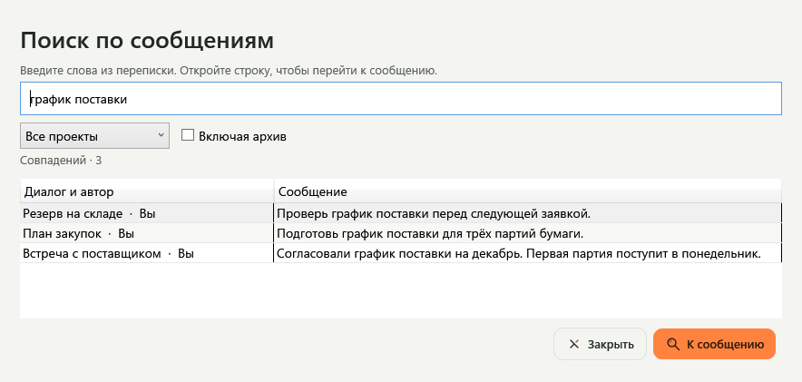

# OSTUM Desktop — offline AI assistant for Windows

[Русская версия](README.md) · [Download for Windows x64](https://github.com/Ranis2023/ostum-desktop/releases/latest/download/Ostum-Desktop-Setup.exe) · [Releases and SHA-256 checksums](https://github.com/Ranis2023/ostum-desktop/releases)

OSTUM runs **Zarum 9B**, a local model based on Qwen3.5-9B, on your own PC. Chat, photo analysis, document reading, dictation and image generation keep working when the network goes down. The interface and built-in help are in Russian.

## New in 5.7

| What you can do | How to try it |
| --- | --- |
| Find an exact message | Press **Ctrl+Shift+F**, enter words from the conversation and open a result. You can filter by project or include archived chats. Search uses saved messages on this PC. |
| Repeat an Excel comparison in Pro | Select two workbooks, choose a sheet and key column on each side, then review changes with the original cell addresses. Save a separate XLSX report or name the workflow to reuse it with the next pair of files. |
| Turn a meeting into minutes | Open **Инструменты → Совещание**. Import a recording or record a microphone, transcribe it locally with Whisper, then ask the local model to find decisions and actions. Listen at a timestamp, correct the speaker names, and select the rows to export as text. Speaker grouping on a single audio channel is approximate. |
| Manage local storage | Open **Модели и настройки → Место на диске** to see free space and the size of individual components. Review and confirm selected caches and inactive modules before removal. Chats, active models and imported GGUF files are protected. Managed workstations have a read-only view. |

View the four features with sample data

This update also brings changes since the 5.4 public release. Version 5.5 added offline OCR for scanned PDFs, invoice review with duplicate detection, spreadsheet range calculations and task calendar exports. Version 5.6 added a local conversation index, faster repeat reads of Office files and improved navigation in long chats. [5.5 changes](packaging/releases/5.5.0.md) · [5.6 changes](packaging/releases/5.6.0.md) · [5.7 release notes in Russian](packaging/releases/5.7.0.md)

## Install on Windows 10 or 11

Download and run **Ostum-Desktop-Setup.exe** (108.3 MiB for 5.7.0). You need Windows x64 and .NET Framework 4.8. On a new PC, the standard installation downloads six model files totalling **13.38 GB** and verifies their SHA-256 hashes. It installs the local engines and adds CUDA acceleration on supported NVIDIA systems. Allow **at least 20 GB of free SSD space** for a full installation. The release is unsigned. [Installer checksum](https://github.com/Ranis2023/ostum-desktop/releases/latest/download/SHA256SUMS.txt)

For an air-gapped PC, prepare an **offline USB folder** on a connected machine. The full 5.7 kit with speech, drawing, music and CUDA occupies about **17.6 GB**. Copy the entire folder to an exFAT or NTFS drive and run its installer on the target PC. Keep `Models`, `Acceleration` and `OSTUM-OFFLINE.txt` beside the EXE. You can also build a local ISO. GitHub Releases hosts the network installer. [USB and ISO preparation commands](README.md#полная-установка-без-интернета) · [Model files and sources](src/catalog.json)

## Chat, files and music

Open **Files** in the chat header to work with Word and Excel beside the conversation. Drag the divider to resize the preview. OSTUM asks for access to a new folder. Ask for a cell change or paragraph rewrite, review the original and proposed values, then save the selected changes. The standalone workspace can move its open document and pending edits back to chat. Project messages stay in the current session.

**Zarum 9B** is the recommended default and takes 6.60 GB including the vision projector. The network installer downloads it during setup. The full USB kit carries both files. The local catalog compares six choices, including Qwen3.5 0.8B, 2B, 4B, 27B and the text-only Qwen3 14B. See the upstream benchmark sources in the [model comparison](README.md#локальные-модели-пользователя).

Ask in Russian to generate instrumental music for 10–60 seconds. The optional ACE-Step download is 2.71 GB. Playback and WAV export are available inside the reply. [Release 5.4.0](packaging/releases/5.4.0.md)

## Release notifications

Starting with 5.3, OSTUM checks GitHub after launch and every six hours. A button in the main window shows the new version. When minimized, OSTUM also sends one Windows notification per release. The app can download the installer in the background and check its published SHA-256 before you click to install and restart. Chats, Pro access and the model library are retained. Click the OSTUM logo to change either preference. Managed installations keep external requests disabled. Users on 5.2 and earlier can update directly by running the current Windows installer.

## What you can do

| Task | How it works |
| --- | --- |
| Talk to a local assistant | Chat with streaming answers, dictate using a selected Windows microphone and listen to local speech output. |
| Work with images and documents | Attach a photograph, a screenshot, a PDF or a DOCX. Version 5.5 reads scanned PDF pages using offline Windows OCR and highlights the selected line. Generate images locally with Z-Image-Turbo after the drawing component is installed. |
| Use multiple agents | For a team request, the analyst and fact checker work in parallel. The chat shows each agent's activity. Web search is optional and off by default. |
| Work on company files in Pro | Open DOCX or XLSX inside the app, review suggested edits and keep versions. Compare two spreadsheets by a key column or create a task linked to the source paragraph or cell. |
| Adapt the model locally | Train a project-specific output-layer LoRA on reviewed question-and-answer examples. Compare the base model and the candidate on held-out examples before enabling it. |
| Bring another local model | Import a compatible GGUF in model settings. Image understanding requires a matching vision projector and a supported architecture. Run the built-in benchmark to measure performance on your PC. |

**Pro access.** The first verified subscription to the developer's Telegram channel unlocks Pro permanently. To activate an isolated workstation, scan its QR code with a connected phone, start the bot and transfer the signed `.ostumpro` response by USB. The response is bound to the Windows user and workstation. [Developer's channel](https://t.me/ranisgaliaskarov) · [Activation bot](https://t.me/rangoostum_bot) · [Company deployment guide in Russian](packaging/Company.md)

## Hardware and performance

For Zarum 9B, 16 GB of system RAM is a practical starting point. A Ryzen 7 7435HS with 16 GB of RAM and an RTX 4050 Laptop GPU with 6 GB of VRAM measured **13.1 tokens/s** on the short built-in CUDA benchmark. The same CPU measured **6.8 tokens/s** on a separate CPU-only run. Model size, context length, available memory and GPU load affect results. [Test conditions and larger configurations](README.md#какой-компьютер-подойдёт)

The desktop app is written in C# and WPF for .NET Framework 4.8. OSTUM code is MIT-licensed. Base models, runtimes and third-party components have their own licences. [MIT licence](LICENSE) · [Component sources](packaging/Sources.txt) · [Russian build guide](README.md#сборка-и-развитие)
