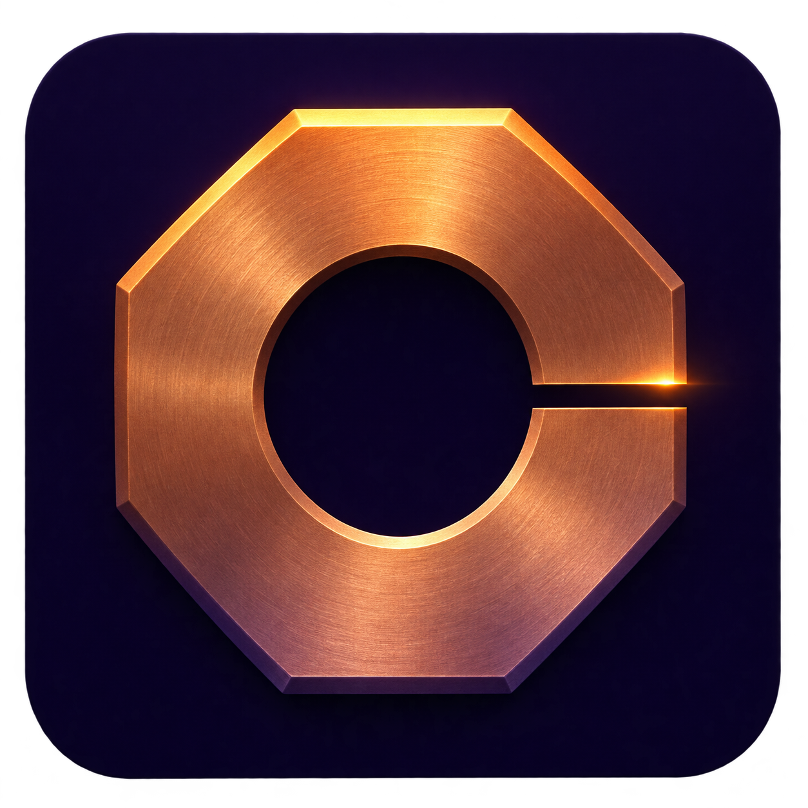

# OSTUM · Ostum Desktop

**Автономный ИИ для Windows на случай, когда интернет недоступен.** Ostum Desktop устанавливается как обычная программа. Его модель **Zarum 9B** ведёт диалог, читает документы и разбирает изображения прямо на компьютере. Можно отключить сеть и продолжить разговор с того же места.

**[Скачать Ostum Desktop для Windows x64](https://github.com/Ranis2023/ostum-desktop/releases/latest/download/Ostum-Desktop-Setup.exe)** · [Все выпуски и контрольные суммы](https://github.com/Ranis2023/ostum-desktop/releases)

## Первый запуск

1. Запустите **Ostum-Desktop-Setup.exe** под своей учётной записью Windows. Установщик добавит приложение и ярлык в меню «Пуск».
2. На новом ПК оставьте сеть включённой до загрузки Zarum. Для текста и зрения вместе нужно **6,60 ГБ** на диске, сверх размера программы. Если веса уже есть, укажите папку в «Модели и настройки».
3. Откройте новый диалог. Например, приложите фотографию и спросите, что на ней видно. Для диктовки или рисования включите соответствующий модуль в «Модели и настройки».

### Установка без доступа к сети

На компьютере, где Zarum уже работает, откройте «Модели и настройки» и посмотрите путь к моделям. Скопируйте на носитель установщик и создайте рядом с ним папку `Models`. Положите в неё **оба** файла Zarum. Скопируйте дополнительные модули, если они понадобятся. Запустите установщик на целевом ПК. Он найдёт папку, проверит SHA-256 и подключит компоненты. Для подготовки из исходников выполните `.\packaging\OfflineModels.ps1 -OutputFolder D:\OstumKit` после сборки установщика. Флаги `-Dictation`, `-Drawing` и `-Cuda` добавляют выбранные модули из установленной библиотеки. Для минимального комплекта используйте пустую папку назначения.

| Компонент | Файлы в папке Models | Размер весов |
| --- | --- | ---: |
| Zarum 9B · текст и зрение | `zarum-9b-q4_k_m.gguf`, `zarum-9b-vision-f16.gguf` | 6,60 ГБ |
| Диктовка · Whisper | `whisper-base-q8.bin` | 81,8 МБ |
| Рисование · Z-Image-Turbo | `z-image-turbo-q4.gguf`, `z-qwen3-text-encoder.gguf`, `z-image-vae.safetensors` | 6,70 ГБ |

Это десятичные размеры файлов моделей. Установщик, локальные движки и дополнительное ускорение NVIDIA занимают место отдельно. Библиотеку моделей можно разместить на другом диске.

## Что умеет приложение

| Задача | Как пользоваться |
| --- | --- |
| **Диалог** | Пишите по-русски или на другом языке модели. Ответ появляется по мере генерации. Для сложного вопроса в настройках можно включить более долгое обдумывание. |
| **Документы** | Приложите PDF с текстовым слоем, DOCX, TXT, Markdown, CSV, TSV, JSON или LOG размером до 32 МиБ. Например, попросите найти сумму договора и показать страницу или абзац, где она указана. Для скана можно приложить изображение страницы. |
| **Зрение** | Прикрепите фотографию, иллюстрацию или снимок экрана. В меню «Инструменты» можно выбрать монитор и сделать разовый снимок. |
| **Оркестратор и агенты** | Обычная просьба получает прямой ответ. При необходимости оркестратор выбирает поиск, расчёт, анализ вложения или команду агентов. В режиме «Поручить команде» аналитик и проверяющий работают параллельно. Рецензент сверяет их выводы, редактор собирает ответ. Маленькие анимированные огоньки в чате показывают роль и занятие каждого участника. |
| **Расчёты** | Калькулятор вычисляет поддерживаемые выражения непосредственно на ПК. Попробуйте «Посчитай 2600 + 350». |
| **Поиск в интернете** | Разрешите веб-поиск в чате и попросите актуальную информацию. Приложение отправит поисковый запрос, прочитает доступные публичные страницы и покажет источники. При новой установке веб-поиск выключен. |
| **Голос** | Стрелка рядом с микрофоном открывает список активных входов Windows. Выберите устройство, нажмите микрофон, произнесите фразу и нажмите «Распознать». В режиме «Голосовой диалог» приложение отправляет распознанную фразу и читает ответ локальным голосом Windows. |
| **Рисование** | Попросите нарисовать изображение или выберите режим рисования. Дополнительный модуль Z-Image-Turbo создаёт картинку локально. Генерация доступна без сети после установки всех трёх файлов модуля. |
| **Работа с Windows** | Через «Инструменты → Окна и приложения» можно переключать и размещать окна, а также открывать предусмотренные приложением программы. Содержимое экрана попадает в чат, когда пользователь прикладывает снимок. |
| **История и архив** | В меню «…» диалога или по правому щелчку выберите «Архивировать диалог». В боковой панели откройте «Архив», чтобы вернуть его. «Удалить диалог…» запрашивает подтверждение и удаляет локальную переписку и принадлежащие только ей копии вложений. |
| **Рабочий профиль** | В «Инструменты → Мой рабочий профиль» задайте сведения о работе и предпочтения к ответам. Профиль, история и персональный адаптер сохраняются в учётной записи Windows. |

## Как устроена Zarum

**Zarum 9B** — название модели в OSTUM. Её основа — мультимодальная **Qwen3.5-9B** от Qwen Team. Приложение использует веса GGUF с квантованием Q4_K_M, зрительный проектор F16 и движок llama.cpp. Одна основная модель обслуживает чат и роли агентов. Отдельные вычислительные движки отвечают за опциональные диктовку и рисование. [Базовая модель Qwen](https://huggingface.co/Qwen/Qwen3.5-9B) · [Файлы GGUF от Unsloth](https://huggingface.co/unsloth/Qwen3.5-9B-GGUF)

В комплект входят два небольших обученных адаптера LoRA. Первый помогает выбрать инструмент для запроса, второй проверяет, подтверждает ли предоставленный материал конкретное утверждение. Персональный адаптер можно обучать отдельно. Изменения рабочего профиля вступают в силу без обучения. Учебные скрипты и открытые синтетические примеры находятся в [training](training), инструменты проверки — в [research](research).

## Хранение и обновления

Приложение ставится для текущего пользователя. Для совместимости с прежней «Сферой» диалоги, архив, профиль и настройки хранятся в `%LOCALAPPDATA%\SferaAI`. При обновлении они подхватываются автоматически. Для резервной копии закройте приложение и скопируйте эту папку. Если библиотека моделей находится в другом месте, скопируйте и её для автономного восстановления.

В главном окне нажмите **логотип OSTUM** или выберите **«Инструменты → О программе и обновлениях»**. Там видны установленная версия и кнопка **«Проверить обновления»**. Если доступен новый выпуск, откройте его и запустите установщик поверх предыдущей версии. Для рабочей машины без сети перенесите новый установщик на носителе. Для локального диалога аккаунт и облачный API-ключ не нужны.

## Сборка и развитие

Проект написан на C# и WPF для Windows x64 с .NET Framework 4.8. Запустите сборку в PowerShell из корня репозитория.

```powershell
.\packaging\Release.ps1
```

Скрипт собирает MSI, формирует установщик, проверяет встроенный пакет и записывает `dist\SHA256SUMS.txt`. При первой сборке нужен доступ к зависимостям. Для разработки интерфейса достаточно `.\build.ps1 -AppOnly`. Чтобы выпустить обновление, измените версию приложения, установщика и MSI, соберите проект, создайте GitHub Release с тегом вида `v4.0.0` и приложите `Ostum-Desktop-Setup.exe` и `SHA256SUMS.txt`. Встроенная проверка читает последний опубликованный стабильный выпуск.

Пример обучения адаптера выбора инструментов при установленной Zarum и стандартной папке моделей. Потребуются Python и NumPy. Команда записывает адаптер и результаты проверки в отдельный каталог.

```powershell
python training/route.py --out training-output/route
```

## Лицензии

Код OSTUM распространяется под [лицензией MIT](LICENSE). Для базовых весов Qwen действует Apache License 2.0. У сторонних движков, весов и библиотек свои условия. Версии, источники и контрольные суммы перечислены в [каталоге моделей](src/catalog.json), [сведениях о компонентах](packaging/Sources.txt) и [сведениях об адаптерах](packaging/Adapter-credits.txt).
