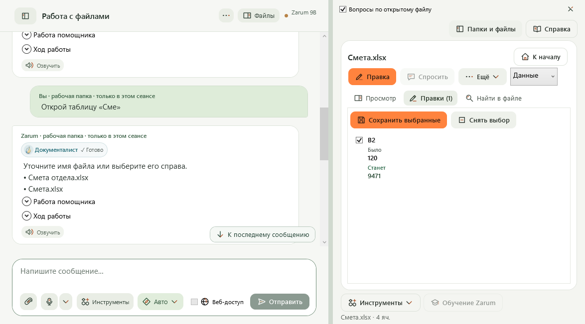

# OSTUM Desktop — автономный ИИ для Windows без лишних действий

[English README](README.en.md) · [Статья «ИИ судного дня»](https://ranis2023.github.io/ostum-desktop/doomsday-ai/) · [Read the article in English](https://ranis2023.github.io/ostum-desktop/en/doomsday-ai/)

Когда пропадает интернет, **Zarum 9B** продолжает отвечать, читать документы и разбирать фотографии прямо на вашем ПК. OSTUM объединяет локальную модель на базе Qwen3.5-9B, параллельных ИИ-агентов, голосовой ввод и генерацию изображений в одном приложении для Windows 10 и 11.

Проверьте, как Zarum читает изображения. Задайте один вопрос к двум запискам с разным временем встречи и номером кабинета. [Скачать обе картинки и посмотреть 35-секундное демо](https://ranis2023.github.io/ostum-desktop/vision-test/).

[Сайт и руководства](https://ranis2023.github.io/ostum-desktop/) · [Пример сверки с двумя XLSX](https://ranis2023.github.io/ostum-desktop/excel/) · [Что нового в 5.7](#что-нового-в-57) · [Требования к ПК](#какой-компьютер-подойдёт) · [Установка с флешки](#полная-установка-без-интернета) · [Для организаций](packaging/Company.md)

**[Скачать OSTUM Desktop для Windows x64](https://github.com/Ranis2023/ostum-desktop/releases/latest/download/Ostum-Desktop-Setup.exe)** · [Контрольная сумма](https://github.com/Ranis2023/ostum-desktop/releases/latest/download/SHA256SUMS.txt) · [Все выпуски](https://github.com/Ranis2023/ostum-desktop/releases)

Установщик версии **5.7.0** занимает **108,3 МиБ**. При первой полной установке на новом ПК оставьте интернет включённым для загрузки **13,38 ГБ** моделей. Затем можно отключиться от сети. Для компьютера без интернета заранее подготовьте полную папку на флешке.

**Для работы в компании** в OSTUM Pro есть редакторы Word и Excel, сверка таблиц по ключу, поручения со ссылкой на абзац или ячейку и локальное дообучение на согласованных примерах. Подпиской на канал можно поблагодарить разработчика. После первой проверки Pro открывается бессрочно. Проверку для изолированного ПК можно пройти с телефона по QR. [Канал Раниса Галиаскарова](https://t.me/ranisgaliaskarov) · [Как открыть Pro](#рабочие-пространства-ostum-pro)


## Что нового в 5.7

| Задача | С чего начать |
| --- | --- |
| Найти старый ответ | Нажмите **Ctrl+Shift+F** или лупу у истории. Введите слова из сообщения, при необходимости выберите проект и включите архив. Откройте результат, чтобы перейти к точной реплике. Поиск работает локально по сохранённой переписке. |
| Повторять одну и ту же сверку Excel | В Pro выберите **Инструменты → Сверить две таблицы Excel**. Сверьте старое и новое значения по исходным ячейкам, сохраните отчёт отдельной книгой. Кнопка **Сохранить сценарий** запомнит листы и ключевые столбцы для следующей пары книг проекта. |
| Получить протокол совещания | Напишите **«Открой совещание»**. Выберите запись или микрофон, нажмите **Распознать**, затем **Найти решения и поручения**. Прослушайте исходные реплики по таймкодам и отметьте, что включить в текстовый протокол. На одной дорожке подписи голосов приблизительны и редактируются вручную. Нужны модуль диктовки и локальная модель для разбора. |
| Освободить место | Напишите **«Покажи место на диске»**. Окно покажет размеры компонентов и свободное место. Отметьте доступные кэши или отключённые модули и подтвердите список. История, активные модели и подключённые GGUF защищены. В корпоративном режиме доступен просмотр. |

<details>
<summary>Посмотреть поиск, сверку, совещание и хранилище на примерах</summary>

**Поиск** находит фразу в трёх учебных диалогах.


**Сверка Excel** показывает изменение цены по ключу A17 и адрес ячейки в каждой книге.


**Совещание** связывает предложение модели с цитатой и временем в записи.


**Хранилище** показывает, какие модули используются и сколько места занимает каждый файл.


</details>

При обновлении с публичной версии 5.4 вы также получаете локальное распознавание сканов, импорт счетов с проверкой повторов, расчёты по диапазонам Excel, экспорт поручений в календарь и ускоренную навигацию по длинным беседам. [Изменения 5.5](packaging/releases/5.5.0.md) · [Изменения 5.6](packaging/releases/5.6.0.md) · [Заметки 5.7](packaging/releases/5.7.0.md)

## Первый запуск

1. Скачайте **Ostum-Desktop-Setup.exe** по ссылке выше и запустите под своей учётной записью. Поддерживаются Windows 10 и 11 x64 с .NET Framework 4.8. Установщик распространяется без подписи издателя. Хеш EXE для проверки опубликован рядом с ним.
2. На новом ПК дождитесь окончания установки с доступом к интернету. EXE содержит приложение, движки, встроенные редакторы, средства обучения и русскую озвучку. Он сам скачает из Hugging Face шесть файлов моделей общим объёмом **13,38 ГБ**, проверит SHA-256 и при подходящей NVIDIA добавит ускорение CUDA. Отдельно искать Python, Office, Ollama, веса или API-ключ не требуется. При обрыве перезапустите этот же установщик.
3. После завершения откройте OSTUM из меню «Пуск». Чат, работа с изображениями, рисование, диктовка, озвучивание, редакторы и обучение работают локально. Выбор «Открыть и скачать позже» устанавливает часть компонентов. Завершить загрузку можно в настройках.

### Как получить новую версию

Начиная с 5.3, OSTUM проверяет GitHub после запуска и каждые шесть часов. Когда выходит новая версия, в шапке чата появляется кнопка с её номером. Для свёрнутого приложения OSTUM отправляет одно уведомление Windows на выпуск. Программа может скачать установщик в фоне и проверяет размер, SHA-256 и версию EXE. Нажмите кнопку и выберите **Установить и перезапустить**. Диалоги, модели и Pro сохраняются. Под логотипом OSTUM можно отдельно отключить уведомления или автоматическую загрузку. В корпоративном режиме действует запрет внешних соединений. В версии 5.2 и более ранних первый переход выполняется запуском нового установщика.

### Полная установка без интернета

На GitHub опубликован сетевой установщик. Для изолированного ПК перенесите **всю подготовленную папку `Ostum-Offline`** на флешку и запустите из неё **Ostum-Desktop-Setup.exe**. Оставьте рядом с EXE папки `Models` и `Acceleration` и файл `OSTUM-OFFLINE.txt`. Полный комплект 5.7 с диктовкой, рисованием, музыкой и CUDA занимает около **17,6 ГБ**. Используйте NTFS или exFAT, поскольку файл Zarum больше 4 ГиБ. Для активации Pro можно передать подтверждение из Telegram с телефона.

**Как подготовить флешку.** На ПК с интернетом выполните полную установку, скачайте музыкальный модуль в программе и подготовьте ускоритель CUDA, если он нужен целевой машине. Скачайте исходники версии 5.7.0, положите установщик этого выпуска по пути `dist\Ostum-Desktop-Setup.exe` и запустите из корня исходников следующие команды. Если библиотека моделей на другом диске, добавьте к первой команде `-ModelDirectory` с её путём.

```powershell
.\packaging\OfflineModels.ps1 -OutputFolder .\dist\Ostum-Offline -InstallerPath .\dist\Ostum-Desktop-Setup.exe -Dictation -Drawing -Music -Cuda -OfflineOnly
.\packaging\OfflineImage.ps1 -Kit .\dist\Ostum-Offline -PrepareOnly
```

Вторая команда проверяет файлы полного комплекта и записывает контрольные суммы. Для создания локального ISO выполните её ещё раз без `-PrepareOnly`. [Скрипт подготовки носителя](packaging/OfflineModels.ps1) · [Сборка образа](packaging/OfflineImage.ps1)

После копирования проверьте саму флешку. Для версии 5.7.0 есть скрипт PowerShell с эталонными SHA-256. Он проверяет 15 файлов полного набора или три файла для чата и фотографий и показывает, что нужно перенести заново. [Инструкция на русском и скрипт](https://gist.github.com/Ranis2023/09103b687eea1f457368782f25628e38#file-02-russian-md)

| Компонент | Файлы в папке Models | Размер весов |
| --- | --- | ---: |
| Zarum 9B · текст и зрение | `zarum-9b-q4_k_m.gguf`, `zarum-9b-vision-f16.gguf` | 6,60 ГБ |
| Диктовка · Whisper | `whisper-base-q8.bin` | 81,8 МБ |
| Рисование · Z-Image-Turbo | `z-image-turbo-q4.gguf`, `z-qwen3-text-encoder.gguf`, `z-image-vae.safetensors` | 6,70 ГБ |
| Музыка · ACE-Step, по желанию | Четыре файла модуля в `Models\music-ace15` | 2,71 ГБ |

Это десятичные размеры файлов моделей. Установщик, локальные движки и дополнительное ускорение NVIDIA занимают место отдельно. Библиотеку моделей можно разместить на другом диске.

## Какой компьютер подойдёт

| Конфигурация | Чего ожидать |
| --- | --- |
| Только CPU, желательно от 16 ГБ ОЗУ для Zarum 9B | На тестовом Ryzen 7 7435HS в режиме CPU короткий запрос с генерацией 24 токенов дал 6,8 токена/с при восьми потоках. Скорость зависит от памяти и процессора. Рисование и обучение могут занимать значительное время. Для коротких ответов можно подключить модель 2B. |
| Ryzen 7 7435HS, 16 ГБ ОЗУ, RTX 4050 Laptop 6 ГБ | Испытанная конфигурация. Встроенный тест Zarum с CUDA и 32 выходными токенами показал 11,0 с на загрузку, 0,25 с до первого токена после загрузки и 13,1 токена/с. Вопрос, занятость видеокарты и контекст меняют результат. |
| Рабочая станция с 32 ГБ ОЗУ и 12–16 ГБ видеопамяти и выше | Больше весов и контекста помещается в GPU. Для 27B учитывайте также размер проектора, служебных буферов и запас памяти Windows. Замер на своей конфигурации доступен в программе. |

Подготовьте от **20 ГБ свободного места на SSD** для полной установки. При хранении ISO на том же диске понадобится дополнительно размер образа. Рабочие документы, рисунки и версии адаптеров требуют отдельного места. Раздел **Модели и настройки → Измерить скорость на этом ПК** показывает время загрузки, задержку до первого токена после загрузки и скорость генерации выбранной модели.

## Рабочие пространства OSTUM Pro

1. Откройте **Рабочие пространства Pro** и подпишитесь на канал. Отсканируйте QR телефоном или откройте бота на этом ПК. Нажмите **Запустить** в чате с **@rangoostum_bot**. Сохраните полученный файл `.ostumpro` и перетащите его в окно доступа. Подтверждение привязано к компьютеру и пользователю Windows. После первой проверки доступ бессрочный. Интернет во время активации нужен только устройству с Telegram. Файл ответа можно принести на флешке. Если камера недоступна, выберите «Передать код без камеры». Подлинное подтверждение 5.1 автоматически даёт бессрочный доступ на прежнем ПК. [Канал](https://t.me/ranisgaliaskarov) · [Бот OSTUM](https://t.me/rangoostum_bot)
2. Перетащите папку, DOCX или XLSX из Проводника. Можно также нажать **Выбрать файл**. При первом открытии OSTUM покажет путь и предложит выбрать доступ к папке. **Только редактор** позволяет работать с документами вручную. **Локальный анализ** позволяет передать выбранный фрагмент в Zarum. **Анализ и обучение** дополнительно разрешает обучаться на проверенных парах вопросов и ответов. В организации папки и права задаёт администратор.
3. Для знакомства нажмите **Открыть учебный пример**. Щёлкните абзац, нажмите **Предложить правку** и проверьте результат на вкладке **Правки**. Кнопка **Сохранить выбранные** записывает отмеченные изменения в документ. Предыдущую редакцию можно вернуть через **Ещё → Версии файла**. Кнопка **Справка** доступна вверху окна.

### Инструменты для предприятия

- **Поручения с источником.** Выберите абзац Word или ячейку Excel и откройте «Ещё → Создать поручение из фрагмента». Рядом с документом появится реестр с ответственным, сроком, статусом, адресом и выдержкой. Из реестра можно перейти к источнику или отметить задачу выполненной.
- **Сверка двух XLSX.** Через «Инструменты → Сверить две таблицы Excel» выберите книги, листы и столбцы с ключом. Отдельный отчёт показывает изменения и адреса ячеек, добавленные и удалённые строки и столбцы, повторяющиеся и пустые ключи.
- **Справка без сети.** Нажмите **F1** в чате, рабочем пространстве или окне активации. В справке есть поиск по разделам и печать. [Файл справки в исходниках](src/OSTUM-Help.html)

После первой проверки ботом 5.2 можно получить файл для следующего компьютера под тем же Telegram-аккаунтом, в том числе после отписки. Файл привязан к конкретной установке. Для участника, который проходил только проверку 5.1, прежнее подтверждение действует локально. При первой выдаче на новом ПК бот может запросить подтверждение подписки.

- **Word.** Открывайте DOCX внутри OSTUM в виде прокручиваемой страницы с абзацами и таблицами, находите нужный абзац или текст в таблице, редактируйте текст и добавляйте комментарии. «Ещё → Сравнить с другим DOCX» показывает вставки, удаления и замены между версиями. Отметьте нужные строки и нажмите «Сохранить выбранные». Сложные поля, рисунки и существующие рецензии лучше редактировать в Word.
- **Excel.** Переключайтесь между листами, находите ячейку по адресу, значению или формуле. Нажмите на ячейку в обычной сетке листа. Меняйте значения и числовые форматы, добавляйте ячейки и проверяйте итог. Редактор пересчитывает базовую арифметику, SUM, AVERAGE, MIN и MAX в пределах листа. Для остальных формул он запрашивает полный пересчёт при следующем открытии в Excel. Фильтр и сортировка заголовков меняют представление в OSTUM.
- **Файлы и версии.** Создавайте папки, документы и книги, копируйте, перемещайте и переименовывайте файлы внутри проекта. Поиск ведёт к абзацу или ячейке. Каждое сохранение оставляет предыдущую версию в папке проекта. При изменении оригинала другой программой OSTUM предложит перечитать файл.
- **Закупки.** В «Примеры и шаблоны» есть сценарий с тремя коммерческими предложениями и обработка собственных XLSX. Итоговая книга содержит количество, единицу, цену без НДС, валюту, ставку налога и ссылку в виде имени исходного файла и адреса ячейки. Цены группируются по позиции, единице и валюте. Пропущенные цены явно помечаются. Курсы и коэффициенты пересчёта не предполагаются.
- **Другие задачи.** Доступны сравнение двух редакций договора, реестр поручений, шаблон сверки счетов и поставок, карточка дела и пустой протокол приёма. Отраслевые карточки служат заготовками для специалиста.
- **Дообучение.** В проекте с соответствующим правом нажмите «Обучение Zarum». Введите пары или импортируйте JSON с полями `prompt`, `answer`, `group`. Удалите ненужные строки и проверьте результат обезличивания. От 5 до 200 пар и минимум три независимые группы. Программа локально обучает LoRA выходного слоя оригинальной Zarum, показывает ответы базы и кандидата на отложенных вопросах, F1 по словам и случаи ухудшения. Версию можно включить только для анализа в этом проекте, отключить, сменить или отозвать. Обучение на личных чатах автоматически не запускается.

### Файлы и компьютер прямо в чате

Нажмите **Файлы** вверху чата или напишите **«Открой папку»**. Для новой папки OSTUM просит выбрать уровень доступа. В Pro документ Word или таблица Excel открывается справа. Потяните разделитель, чтобы оставить больше места тексту или таблице. В отдельном рабочем пространстве кнопка **В чат** переносит открытый редактор вместе с отмеченными правками.

- **«Открой документ»** предлагает выбрать файл. **«Можешь открыть таблицу Смета?»** ищет её по имени в разрешённой папке. Если подходят несколько файлов, OSTUM попросит уточнить. **«Создай таблицу Смета.xlsx»** создаёт книгу в рабочей папке. **«Покажи файлы в папке»** выводит список.
- **«Измени ячейку B2 на 1450»** или **«Переформулируй абзац 2 проще»** показывает исходное и предложенное значения. Команда **«Сохрани выбранные правки»** применяет отмеченные изменения. **«Найди в проекте поставка»** ищет по файлам разрешённой папки.
- Включённый флажок **Вопросы по открытому файлу** передаёт локальной Zarum выбранный фрагмент или выдержки текущего документа или листа. Для этого требуется доступ «Локальный анализ». Для ранее подключённой папки прежнее разрешение охватывает выбранный фрагмент. Чтобы разрешить подбор выдержек из всего открытого документа, подтвердите «Локальный анализ» в «Доступ к папке». Реплики о рабочей папке видны в текущем сеансе. В обычную историю на диске и в следующие запросы общего чата они не записываются.
- **«Какие окна открыты?»**, **«Сверни окно …»**, **«Открой калькулятор»** и запрос снимка экрана используют инструменты Windows в пределах действующих разрешений.
- Для буквальной сверки двух прикреплённых версий отправьте оба вложения по очереди и напишите **«Сравни две версии»**. OSTUM покажет, какие текстовые фрагменты добавлены, удалены или переставлены, с указанием исходных файлов.



### Музыка без интернета

В чате напишите **«Сгенерируй музыку на 12 секунд для заставки, спокойная электроника»**. При первом таком запросе OSTUM предложит загрузить дополнительный модуль ACE-Step объёмом **2,71 ГБ**. Дальше инструментальные треки продолжительностью от 10 до 60 секунд создаются локально. Ответ содержит проигрывание и сохранение WAV. Для флешки с музыкой добавьте `-Music` при подготовке комплекта из библиотеки, где модуль уже установлен. [Движок ACE-Step](https://github.com/ace-step/acestep.vst3/releases/tag/v0.1.0) · [Веса GGUF](https://huggingface.co/Serveurperso/ACE-Step-1.5-GGUF)

### Локальные модели пользователя

В **Модели и настройки → Открыть GGUF с диска** выберите основные веса совместимой модели. Части многотомного GGUF должны лежать рядом. Для анализа картинок нужен соответствующий проектор. Файлы подключаются с исходного диска. В каталоге **Zarum 9B** отмечена звездой и использует те же файлы, которые поставляются при установке. Обычный EXE скачивает её веса при первом запуске установщика. В полном USB-комплекте оба файла уже есть. Перед переключением OSTUM запрашивает короткий ответ у нового движка. При ошибке выбора сохраняется рабочая модель. Поддержка новых архитектур зависит от установленной версии llama.cpp. Адаптеры Zarum привязаны к её базовым весам.

| Модель | Объём с модулем фото, если он есть | Фото | MMLU-Pro исходной модели |
| --- | ---: | :---: | ---: |
| Qwen3.5 0.8B | 0,74 ГБ | Да | 42,3 |
| Qwen3.5 2B | 1,95 ГБ | Да | 66,5 |
| Qwen3.5 4B | 3,41 ГБ | Да | 79,1 |
| **Zarum 9B · рекомендуется** | **6,60 ГБ** | **Да** | **82,5** |
| Qwen3 14B | 9,00 ГБ | — | Нет сопоставимой оценки |
| Qwen3.5 27B | 17,67 ГБ | Да | 86,1 |

MMLU-Pro показывает долю правильных ответов на набор вопросов. Приведены опубликованные результаты Qwen для базовых моделей с рассуждением. Скорость и результат локальных сжатых GGUF зависят от режима, задачи и памяти. Каталог сверяет ориентиры с ОЗУ и доступными сведениями о NVIDIA. Скорость выбранной модели можно измерить кнопкой в настройках. [0.8B и 2B](https://huggingface.co/Qwen/Qwen3.5-2B) · [4B и 9B](https://huggingface.co/Qwen/Qwen3.5-9B) · [27B](https://huggingface.co/Qwen/Qwen3.5-27B)

### Развёртывание в компании

На управляемом ПК OSTUM берёт перечень папок и полномочия из `%ProgramData%\OSTUM\policy.json`. В этом режиме приложение отключает внешние обращения, веб-поиск, обновления и внешние ссылки. Локальный движок слушает только 127.0.0.1. Доступ к документам определяется также учётной записью Windows и правами на реальные файлы. Администратору доступны пример политики и порядок проверки перед внедрением. [Корпоративная установка](packaging/Company.md)

## Что умеет приложение

| Задача | Как пользоваться |
| --- | --- |
| **Диалог** | Пишите по-русски или на другом языке модели. Ответ появляется по мере генерации. Для сложного вопроса в настройках можно включить более долгое обдумывание. |
| **Документы** | Приложите PDF с текстовым слоем, DOCX, TXT, Markdown, CSV, TSV, JSON или LOG размером до 32 МиБ. Например, попросите найти сумму договора и показать страницу или абзац, где она указана. В версии 5.5 сканы PDF читает локальный OCR Windows. Выберите строку, чтобы увидеть её на странице. |
| **Зрение** | Прикрепите фотографию, иллюстрацию или снимок экрана. В меню «Инструменты» можно выбрать монитор и сделать разовый снимок. |
| **Оркестратор и агенты** | Обычная просьба получает прямой ответ. При необходимости оркестратор выбирает поиск, расчёт, анализ вложения или команду агентов. В режиме «Поручить команде» аналитик и проверяющий работают параллельно. Рецензент сверяет их выводы, редактор собирает ответ. Маленькие анимированные огоньки в чате показывают роль и занятие каждого участника. |
| **Расчёты** | Калькулятор вычисляет поддерживаемые выражения непосредственно на ПК. Попробуйте «Посчитай 2600 + 350». |
| **Поиск в интернете** | Разрешите веб-поиск в чате и попросите актуальную информацию. Приложение отправит поисковый запрос, прочитает доступные публичные страницы и покажет источники. При новой установке веб-поиск выключен. |
| **Голос** | Стрелка рядом с микрофоном открывает список активных входов Windows. Выберите устройство, нажмите микрофон, произнесите фразу и нажмите «Распознать». В режиме «Голосовой диалог» приложение отправляет распознанную фразу и читает ответ локальным голосом Windows. |
| **Рисование** | Попросите нарисовать изображение или выберите режим рисования. Дополнительный модуль Z-Image-Turbo создаёт картинку локально. Генерация доступна без сети после установки всех трёх файлов модуля. |
| **Работа с Windows** | Через «Инструменты → Окна и приложения» можно переключать и размещать окна, а также открывать предусмотренные приложением программы. Содержимое экрана попадает в чат, когда пользователь прикладывает снимок. |
| **История и архив** | В меню «…» диалога или по правому щелчку выберите «Архивировать диалог». В боковой панели откройте «Архив», чтобы вернуть его. «Удалить диалог…» запрашивает подтверждение и удаляет локальную переписку и принадлежащие только ей копии вложений. |
| **Рабочий профиль** | В «Инструменты → Мой рабочий профиль» задайте сведения о работе и предпочтения к ответам. Профиль, история и персональный адаптер сохраняются в учётной записи Windows. |

## Как устроена Zarum

**Zarum 9B** — название модели в OSTUM. Её основа — мультимодальная **Qwen3.5-9B** от Qwen Team. Приложение использует веса GGUF с квантованием Q4_K_M, зрительный проектор F16 и движок llama.cpp. Одна основная модель обслуживает чат и роли агентов. Отдельные вычислительные движки отвечают за опциональные диктовку и рисование. [Базовая модель Qwen](https://huggingface.co/Qwen/Qwen3.5-9B) · [Файлы GGUF от Unsloth](https://huggingface.co/unsloth/Qwen3.5-9B-GGUF)

В комплект входят два небольших обученных адаптера LoRA. Первый помогает выбрать инструмент для запроса, второй проверяет, подтверждает ли предоставленный материал конкретное утверждение. Персональный адаптер можно обучать отдельно. Изменения рабочего профиля вступают в силу без обучения. Учебные скрипты и открытые синтетические примеры находятся в [training](training), инструменты проверки — в [research](research).

## Хранение и обновления

Приложение ставится для текущего пользователя. Для совместимости с прежней «Сферой» диалоги, архив, профиль и настройки хранятся в `%LOCALAPPDATA%\SferaAI`. При обновлении они подхватываются автоматически. Для резервной копии закройте приложение и скопируйте эту папку. Если библиотека моделей находится в другом месте, скопируйте и её для автономного восстановления.

В главном окне нажмите **логотип OSTUM** или выберите **«Инструменты → О программе и обновлениях»**. Там видны установленная версия и кнопка **«Проверить обновления»**. Если доступен новый выпуск, откройте его и запустите установщик поверх предыдущей версии. Для рабочей машины без сети перенесите новый установщик на носителе. Для локального диалога аккаунт и облачный API-ключ не нужны.

## Сборка и развитие

Проект написан на C# и WPF для Windows x64 с .NET Framework 4.8. Запустите сборку в PowerShell из корня репозитория.

```powershell
.\packaging\Release.ps1
```

Скрипт собирает MSI, формирует установщик, проверяет встроенный пакет и записывает `dist\SHA256SUMS.txt`. При первой сборке нужен доступ к зависимостям. Для разработки интерфейса достаточно `.\build.ps1 -AppOnly`. Чтобы выпустить обновление, измените версию приложения, установщика и MSI, соберите проект, создайте GitHub Release с тегом вида `v5.0.0` и приложите `Ostum-Desktop-Setup.exe` и `SHA256SUMS.txt`. Встроенная проверка читает последний опубликованный стабильный выпуск.

При выпуске через GitHub CLI отправьте проверенный коммит в main и запустите `.\packaging\Publish.ps1` из учётной записи владельца. Скрипт загружает EXE и контрольную сумму в черновик, сверяет размеры и SHA-256 на стороне GitHub и затем публикует выпуск. Для проверки и публикации ранее собранного установщика можно указать каталог через `-DistributionDirectory` в `Release.ps1 -UseExistingBuild` и `Publish.ps1`. [Заметки выпуска 5.7.0](packaging/releases/5.7.0.md) · [Настройка бота издателем](subscription/README.md)

Пример обучения адаптера выбора инструментов при установленной Zarum и стандартной папке моделей. Потребуются Python и NumPy. Команда записывает адаптер и результаты проверки в отдельный каталог.

```powershell
python training/route.py --out training-output/route
```

## Материалы и участие

Обзор «ИИ судного дня» доступен на русском и английском. На сайте можно сменить язык и продолжить читать ту же статью или руководство. В авторской статье на vc.ru можно повторить три проверки с инструкцией в PDF, двумя прайсами и записью поручения. [Три опыта на vc.ru](https://vc.ru/ai/3270932-fleshka-s-iskusstvennym-intellektom-ostum-desktop) · [Русская версия на Mataroa](https://ostumdesktop.mataroa.blog/blog/ii-sudnogo-dnya/) · [Русская версия в Telegraph](https://telegra.ph/II-sudnogo-dnya-11-21) · [Обсуждение на двух языках](https://github.com/Ranis2023/ostum-desktop/discussions/3)

| Практикум | Русский | English |
| --- | --- | --- |
| Проверить три расхождения в двух прайсах | [Разбор с двумя XLSX](https://ostumdesktop.mataroa.blog/blog/sverka-excel-bez-interneta/) | [Technical walkthrough on DEV](https://dev.to/ranis2023/reconciling-two-excel-workbooks-offline-with-a-local-windows-ai-assistant-17bb) |
| Сверить поручение с записью совещания | [Протокол с цитатами](https://telegra.ph/Kak-poluchit-protokol-soveshchaniya-bez-oblaka-i-proverit-kazhdoe-poruchenie-11-21) | [Meeting minutes with timestamps](https://ostumdesktop.mataroa.blog/blog/meeting-minutes-you-can-check-against-the-recording/) |

Новые статьи проекта можно читать по RSS. [Лента блога OSTUM](https://ostumdesktop.mataroa.blog/rss/) · [Короткий практикум с прайсами в Telegram](https://t.me/ranisgaliaskarov/236)

Первый вклад можно сделать со своего Windows-компьютера. Запустите встроенный тест скорости Zarum 9B и дополните опубликованный замер результатом на другом процессоре. [Задача с порядком измерения](https://github.com/Ranis2023/ostum-desktop/issues/2) · [Обсуждения проекта](https://github.com/Ranis2023/ostum-desktop/discussions)

## Лицензии

Код OSTUM распространяется под [лицензией MIT](LICENSE). Для базовых весов Qwen действует Apache License 2.0. У сторонних движков, весов и библиотек свои условия. Версии, источники и контрольные суммы перечислены в [каталоге моделей](src/catalog.json), [сведениях о компонентах](packaging/Sources.txt) и [сведениях об адаптерах](packaging/Adapter-credits.txt).
