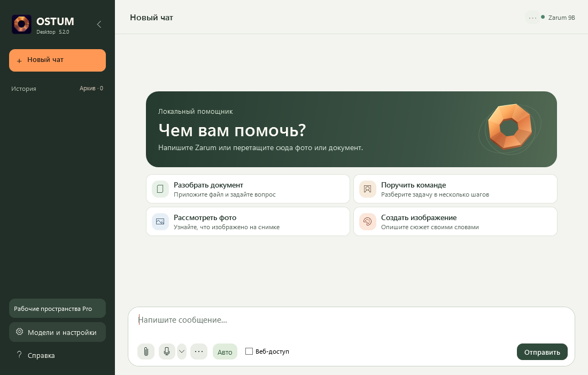

# OSTUM · Ostum Desktop

**Автономный ИИ для Windows на случай, когда интернет недоступен.** Ostum Desktop устанавливается как обычная программа. Его модель **Zarum 9B** ведёт диалог, читает документы и разбирает изображения прямо на компьютере. Можно отключить сеть и продолжить разговор с того же места.

**[Скачать Ostum Desktop для Windows x64](https://github.com/Ranis2023/ostum-desktop/releases/latest/download/Ostum-Desktop-Setup.exe)** · [Все выпуски и контрольные суммы](https://github.com/Ranis2023/ostum-desktop/releases)

Поблагодарить разработчика можно подпиской на его Telegram-канал. В версии 5.2 первая подтверждённая подписка открывает рабочие пространства Pro бессрочно. Базовый чат, голос и генерация изображений доступны сразу. [Канал Раниса Галиаскарова](https://t.me/ranisgaliaskarov)

## Первый запуск

1. Скачайте **Ostum-Desktop-Setup.exe** по ссылке выше и запустите под своей учётной записью. Поддерживаются Windows 10 и 11 x64 с .NET Framework 4.8. Установщик распространяется без подписи издателя. Хеш EXE для проверки опубликован рядом с ним.
2. На новом ПК дождитесь окончания установки с доступом к интернету. EXE содержит приложение, движки, встроенные редакторы, средства обучения и русскую озвучку. Он сам скачает из Hugging Face шесть файлов моделей общим объёмом **13,38 ГБ**, проверит SHA-256 и при подходящей NVIDIA добавит ускорение CUDA. Отдельно искать Python, Office, Ollama, веса или API-ключ не требуется. При обрыве перезапустите этот же установщик.
3. После завершения откройте OSTUM из меню «Пуск». Чат, работа с изображениями, рисование, диктовка, озвучивание, редакторы и обучение работают локально. Выбор «Открыть и скачать позже» устанавливает часть компонентов. Завершить загрузку можно в настройках.

### Полная установка без интернета

Для изолированного компьютера перенесите подготовленный **OSTUM-Desktop-5.2.0-Offline.iso**. Откройте образ в Проводнике и запустите находящийся внутри **Ostum-Desktop-Setup.exe**. Такой же установщик можно запустить из полной папки **Ostum-Pro-Offline** на USB-накопителе. Маркер комплекта включает автономный режим. Все шесть весов и библиотеки NVIDIA уже на носителе. Для Pro файл подтверждения подписки можно получить в Telegram с другого устройства. ISO собирается локально. Для GitHub Releases предназначен сетевой установщик. Один файл вложения выпуска GitHub должен быть меньше 2 ГиБ. [Документация GitHub](https://docs.github.com/en/repositories/releasing-projects-on-github/about-releases)

Для подготовки такого носителя из проверенной локальной библиотеки выполните следующие команды после сборки выпуска.

```powershell
.\packaging\OfflineModels.ps1 -OutputFolder .\dist\Ostum-Pro-Offline -Dictation -Drawing -Cuda
.\packaging\OfflineImage.ps1
```

| Компонент | Файлы в папке Models | Размер весов |
| --- | --- | ---: |
| Zarum 9B · текст и зрение | `zarum-9b-q4_k_m.gguf`, `zarum-9b-vision-f16.gguf` | 6,60 ГБ |
| Диктовка · Whisper | `whisper-base-q8.bin` | 81,8 МБ |
| Рисование · Z-Image-Turbo | `z-image-turbo-q4.gguf`, `z-qwen3-text-encoder.gguf`, `z-image-vae.safetensors` | 6,70 ГБ |

Это десятичные размеры файлов моделей. Установщик, локальные движки и дополнительное ускорение NVIDIA занимают место отдельно. Библиотеку моделей можно разместить на другом диске.

## Какой компьютер подойдёт

| Конфигурация | Чего ожидать |
| --- | --- |
| Только CPU, желательно от 16 ГБ ОЗУ для Zarum 9B | На тестовом Ryzen 7 7435HS в режиме CPU короткий запрос с генерацией 24 токенов дал 6,8 токена/с при восьми потоках. Скорость зависит от памяти и процессора. Рисование и обучение могут занимать значительное время. Для коротких ответов можно подключить модель 2B. |
| Ryzen 7 7435HS, 16 ГБ ОЗУ, RTX 4050 Laptop 6 ГБ | Испытанная конфигурация. Встроенный тест Zarum с CUDA и 32 выходными токенами показал 11,0 с на загрузку, 0,25 с до первого токена после загрузки и 13,1 токена/с. Вопрос, занятость видеокарты и контекст меняют результат. |
| Рабочая станция с 32 ГБ ОЗУ и 12–16 ГБ видеопамяти и выше | Больше весов и контекста помещается в GPU. Для 27B учитывайте также размер проектора, служебных буферов и запас памяти Windows. Замер на своей конфигурации доступен в программе. |

Подготовьте от **20 ГБ свободного места на SSD** для полной установки. При хранении ISO на том же диске понадобится дополнительно размер образа. Рабочие документы, рисунки и версии адаптеров требуют отдельного места. Раздел **Модели и настройки → Измерить скорость на этом ПК** показывает время загрузки, задержку до первого токена после загрузки и скорость генерации выбранной модели.

## Рабочие пространства OSTUM Pro

1. Откройте **Рабочие пространства Pro** и подпишитесь на канал. Отсканируйте QR телефоном или откройте бота на этом ПК. Нажмите **Запустить** в чате с **@rangoostum_bot**. Сохраните полученный файл `.ostumpro` и перетащите его в окно доступа. Подтверждение привязано к компьютеру и пользователю Windows. После первой проверки доступ бессрочный. Интернет во время активации нужен только устройству с Telegram. Файл ответа можно принести на флешке. Если камера недоступна, выберите «Передать код без камеры». Подлинное подтверждение 5.1 автоматически даёт бессрочный доступ на прежнем ПК. [Канал](https://t.me/ranisgaliaskarov) · [Бот OSTUM](https://t.me/rangoostum_bot)
2. Перетащите папку, DOCX или XLSX из Проводника. Можно также нажать **Выбрать файл**. При первом открытии OSTUM покажет путь и предложит выбрать доступ к папке. **Только редактор** позволяет работать с документами вручную. **Локальный анализ** позволяет передать выбранный фрагмент в Zarum. **Анализ и обучение** дополнительно разрешает обучаться на проверенных парах вопросов и ответов. В организации папки и права задаёт администратор.
3. Для знакомства нажмите **Открыть учебный пример**. Щёлкните абзац, нажмите **Предложить правку** и проверьте результат на вкладке **Правки**. Кнопка **Сохранить выбранные** записывает отмеченные изменения в документ. Предыдущую редакцию можно вернуть через **Ещё → Версии файла**. Кнопка **Справка** доступна вверху окна.



### Инструменты для предприятия

- **Поручения с источником.** Выберите абзац Word или ячейку Excel и откройте «Ещё → Создать поручение из фрагмента». Рядом с документом появится реестр с ответственным, сроком, статусом, адресом и выдержкой. Из реестра можно перейти к источнику или отметить задачу выполненной.
- **Сверка двух XLSX.** Через «Инструменты → Сверить две таблицы Excel» выберите книги, листы и столбцы с ключом. Отдельный отчёт показывает изменения и адреса ячеек, добавленные и удалённые строки и столбцы, повторяющиеся и пустые ключи.
- **Справка без сети.** Нажмите **F1** в чате, рабочем пространстве или окне активации. В справке есть поиск по разделам и печать. [Файл справки в исходниках](src/OSTUM-Help.html)

После первой проверки ботом 5.2 можно получить файл для следующего компьютера под тем же Telegram-аккаунтом, в том числе после отписки. Файл привязан к конкретной установке. Для участника, который проходил только проверку 5.1, прежнее подтверждение действует локально. При первой выдаче на новом ПК бот может запросить подтверждение подписки.

- **Word.** Открывайте DOCX внутри OSTUM в виде прокручиваемой страницы с абзацами и таблицами, находите нужный абзац или текст в таблице, редактируйте текст и добавляйте комментарии. «Ещё → Сравнить с другим DOCX» показывает вставки, удаления и замены между версиями. Отметьте нужные строки и нажмите «Сохранить выбранные». Сложные поля, рисунки и существующие рецензии лучше редактировать в Word.
- **Excel.** Переключайтесь между листами, находите ячейку по адресу, значению или формуле. Нажмите на ячейку в обычной сетке листа. Меняйте значения и числовые форматы, добавляйте ячейки и проверяйте итог. Редактор пересчитывает базовую арифметику, SUM, AVERAGE, MIN и MAX в пределах листа. Для остальных формул он запрашивает полный пересчёт при следующем открытии в Excel. Фильтр и сортировка заголовков меняют представление в OSTUM.
- **Файлы и версии.** Создавайте папки, документы и книги, копируйте, перемещайте и переименовывайте файлы внутри проекта. Поиск ведёт к абзацу или ячейке. Каждое сохранение оставляет предыдущую версию в папке проекта. При изменении оригинала другой программой OSTUM предложит перечитать файл.
- **Закупки.** В «Примеры и шаблоны» есть сценарий с тремя коммерческими предложениями и обработка собственных XLSX. Итоговая книга содержит количество, единицу, цену без НДС, валюту, ставку налога и ссылку в виде имени исходного файла и адреса ячейки. Цены группируются по позиции, единице и валюте. Пропущенные цены явно помечаются. Курсы и коэффициенты пересчёта не предполагаются.
- **Другие задачи.** Доступны сравнение двух редакций договора, реестр поручений, шаблон сверки счетов и поставок, карточка дела и пустой протокол приёма. Отраслевые карточки служат заготовками для специалиста.
- **Дообучение.** В проекте с соответствующим правом нажмите «Обучение Zarum». Введите пары или импортируйте JSON с полями `prompt`, `answer`, `group`. Удалите ненужные строки и проверьте результат обезличивания. От 5 до 200 пар и минимум три независимые группы. Программа локально обучает LoRA выходного слоя оригинальной Zarum, показывает ответы базы и кандидата на отложенных вопросах, F1 по словам и случаи ухудшения. Версию можно включить только для анализа в этом проекте, отключить, сменить или отозвать. Обучение на личных чатах автоматически не запускается.

### Локальные модели пользователя

В **Модели и настройки → Открыть GGUF с диска** выберите основные веса совместимой модели. Части многотомного GGUF должны лежать рядом. Для анализа картинок нужен соответствующий проектор. Файлы подключаются с исходного диска. Встроенный каталог также умеет скачать проверенные по хешам Qwen3.5 2B и 27B. Перед переключением OSTUM запрашивает короткий ответ у нового движка. При ошибке выбора сохраняется рабочая модель. Поддержка новых архитектур зависит от установленной версии llama.cpp. Адаптеры Zarum привязаны к её базовым весам.

### Развёртывание в компании

На управляемом ПК OSTUM берёт перечень папок и полномочия из `%ProgramData%\OSTUM\policy.json`. В этом режиме приложение отключает внешние обращения, веб-поиск, обновления и внешние ссылки. Локальный движок слушает только 127.0.0.1. Доступ к документам определяется также учётной записью Windows и правами на реальные файлы. Администратору доступны пример политики и порядок проверки перед внедрением. [Корпоративная установка](packaging/Company.md)

## Что умеет приложение

| Задача | Как пользоваться |
| --- | --- |
| **Диалог** | Пишите по-русски или на другом языке модели. Ответ появляется по мере генерации. Для сложного вопроса в настройках можно включить более долгое обдумывание. |
| **Документы** | Приложите PDF с текстовым слоем, DOCX, TXT, Markdown, CSV, TSV, JSON или LOG размером до 32 МиБ. Например, попросите найти сумму договора и показать страницу или абзац, где она указана. Для скана можно приложить изображение страницы. |
| **Зрение** | Прикрепите фотографию, иллюстрацию или снимок экрана. В меню «Инструменты» можно выбрать монитор и сделать разовый снимок. |
| **Оркестратор и агенты** | Обычная просьба получает прямой ответ. При необходимости оркестратор выбирает поиск, расчёт, анализ вложения или команду агентов. В режиме «Поручить команде» аналитик и проверяющий работают параллельно. Рецензент сверяет их выводы, редактор собирает ответ. Маленькие анимированные огоньки в чате показывают роль и занятие каждого участника. |
| **Расчёты** | Калькулятор вычисляет поддерживаемые выражения непосредственно на ПК. Попробуйте «Посчитай 2600 + 350». |
| **Поиск в интернете** | Разрешите веб-поиск в чате и попросите актуальную информацию. Приложение отправит поисковый запрос, прочитает доступные публичные страницы и покажет источники. При новой установке веб-поиск выключен. |
| **Голос** | Стрелка рядом с микрофоном открывает список активных входов Windows. Выберите устройство, нажмите микрофон, произнесите фразу и нажмите «Распознать». В режиме «Голосовой диалог» приложение отправляет распознанную фразу и читает ответ локальным голосом Windows. |
| **Рисование** | Попросите нарисовать изображение или выберите режим рисования. Дополнительный модуль Z-Image-Turbo создаёт картинку локально. Генерация доступна без сети после установки всех трёх файлов модуля. |
| **Работа с Windows** | Через «Инструменты → Окна и приложения» можно переключать и размещать окна, а также открывать предусмотренные приложением программы. Содержимое экрана попадает в чат, когда пользователь прикладывает снимок. |
| **История и архив** | В меню «…» диалога или по правому щелчку выберите «Архивировать диалог». В боковой панели откройте «Архив», чтобы вернуть его. «Удалить диалог…» запрашивает подтверждение и удаляет локальную переписку и принадлежащие только ей копии вложений. |
| **Рабочий профиль** | В «Инструменты → Мой рабочий профиль» задайте сведения о работе и предпочтения к ответам. Профиль, история и персональный адаптер сохраняются в учётной записи Windows. |

## Как устроена Zarum

**Zarum 9B** — название модели в OSTUM. Её основа — мультимодальная **Qwen3.5-9B** от Qwen Team. Приложение использует веса GGUF с квантованием Q4_K_M, зрительный проектор F16 и движок llama.cpp. Одна основная модель обслуживает чат и роли агентов. Отдельные вычислительные движки отвечают за опциональные диктовку и рисование. [Базовая модель Qwen](https://huggingface.co/Qwen/Qwen3.5-9B) · [Файлы GGUF от Unsloth](https://huggingface.co/unsloth/Qwen3.5-9B-GGUF)

В комплект входят два небольших обученных адаптера LoRA. Первый помогает выбрать инструмент для запроса, второй проверяет, подтверждает ли предоставленный материал конкретное утверждение. Персональный адаптер можно обучать отдельно. Изменения рабочего профиля вступают в силу без обучения. Учебные скрипты и открытые синтетические примеры находятся в [training](training), инструменты проверки — в [research](research).

## Хранение и обновления

Приложение ставится для текущего пользователя. Для совместимости с прежней «Сферой» диалоги, архив, профиль и настройки хранятся в `%LOCALAPPDATA%\SferaAI`. При обновлении они подхватываются автоматически. Для резервной копии закройте приложение и скопируйте эту папку. Если библиотека моделей находится в другом месте, скопируйте и её для автономного восстановления.

В главном окне нажмите **логотип OSTUM** или выберите **«Инструменты → О программе и обновлениях»**. Там видны установленная версия и кнопка **«Проверить обновления»**. Если доступен новый выпуск, откройте его и запустите установщик поверх предыдущей версии. Для рабочей машины без сети перенесите новый установщик на носителе. Для локального диалога аккаунт и облачный API-ключ не нужны.

## Сборка и развитие

Проект написан на C# и WPF для Windows x64 с .NET Framework 4.8. Запустите сборку в PowerShell из корня репозитория.

```powershell
.\packaging\Release.ps1
```

Скрипт собирает MSI, формирует установщик, проверяет встроенный пакет и записывает `dist\SHA256SUMS.txt`. При первой сборке нужен доступ к зависимостям. Для разработки интерфейса достаточно `.\build.ps1 -AppOnly`. Чтобы выпустить обновление, измените версию приложения, установщика и MSI, соберите проект, создайте GitHub Release с тегом вида `v5.0.0` и приложите `Ostum-Desktop-Setup.exe` и `SHA256SUMS.txt`. Встроенная проверка читает последний опубликованный стабильный выпуск.

При выпуске через GitHub CLI отправьте проверенный коммит в main и запустите `.\packaging\Publish.ps1` из учётной записи владельца. Скрипт загружает EXE и контрольную сумму в черновик, сверяет размеры и SHA-256 на стороне GitHub и затем публикует выпуск. [Заметки выпуска 5.2.0](packaging/releases/5.2.0.md) · [Настройка бота издателем](subscription/README.md)

Пример обучения адаптера выбора инструментов при установленной Zarum и стандартной папке моделей. Потребуются Python и NumPy. Команда записывает адаптер и результаты проверки в отдельный каталог.

```powershell
python training/route.py --out training-output/route
```

## Лицензии

Код OSTUM распространяется под [лицензией MIT](LICENSE). Для базовых весов Qwen действует Apache License 2.0. У сторонних движков, весов и библиотек свои условия. Версии, источники и контрольные суммы перечислены в [каталоге моделей](src/catalog.json), [сведениях о компонентах](packaging/Sources.txt) и [сведениях об адаптерах](packaging/Adapter-credits.txt).
