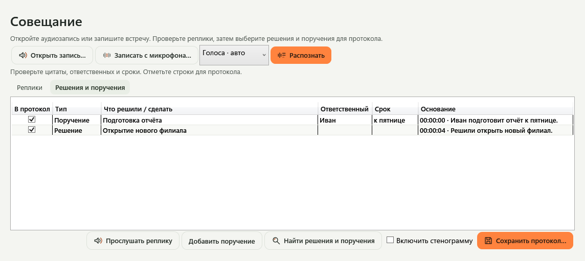

# OSTUM Desktop 5.7.0

[English release notes](https://github.com/Ranis2023/ostum-desktop/blob/main/packaging/releases/5.7.0.md#english-release-notes) · [Русская документация](https://github.com/Ranis2023/ostum-desktop/blob/main/README.md) · [English documentation](https://github.com/Ranis2023/ostum-desktop/blob/main/README.en.md)

Теперь можно найти конкретную реплику в старом чате, повторить сверку Excel на новых книгах и превратить запись совещания в протокол с проверяемыми цитатами. Все три задачи выполняются на вашем ПК.

**[Скачать установщик для Windows 10 и 11 x64](https://github.com/Ranis2023/ostum-desktop/releases/download/v5.7.0/Ostum-Desktop-Setup.exe)** · [Контрольная сумма SHA-256](https://github.com/Ranis2023/ostum-desktop/releases/download/v5.7.0/SHA256SUMS.txt) · [English guide](https://github.com/Ranis2023/ostum-desktop/blob/v5.7.0/README.en.md)

## Что попробовать

- **Найти сообщение.** Нажмите **Ctrl+Shift+F** и введите слова из переписки. Можно выбрать проект или включить архив. Результат открывает нужную реплику в диалоге. Поиск использует сохранённую историю с учётом правил организации.
- **Сверить книги в Pro.** Напишите **«Сверь две таблицы Excel»**. Выберите листы и ключевые столбцы, проверьте значения и адреса ячеек, сохраните отдельный отчёт XLSX. Запомните настройки кнопкой **Сохранить сценарий**. Когда придут следующие файлы, напишите **«Запусти сценарий сверки»**.
- **Подготовить протокол.** Напишите **«Открой совещание»**, выберите файл или запишите встречу с микрофона. Whisper распознаёт до четырёх часов аудио. Уточните текст и подписи участников, прослушайте цитату по таймкоду и проверьте предложенные локальной моделью решения, ответственных и сроки. В текстовый протокол попадут отмеченные строки. При одном микрофоне группировка голосов приблизительна.
- **Посмотреть, чем занят диск.** Напишите **«Покажи место на диске»**. Выберите кэши и отключённые модули, проверьте список и подтвердите очистку. Активные компоненты, пользовательские GGUF и история защищены. Для управляемых рабочих станций доступен просмотр.



[Все скриншоты и примеры](https://github.com/Ranis2023/ostum-desktop/blob/v5.7.0/README.md#что-нового-в-57) · [Локальная справка приложения](https://github.com/Ranis2023/ostum-desktop/blob/v5.7.0/src/OSTUM-Help.html)

## Если вы обновляетесь с 5.4

В эту версию также вошли распознавание сканов PDF на ПК, проверка входящих счетов и дубликатов, расчёты по диапазонам Excel, проверка нескольких правок за один запрос и экспорт сроков в календарь. В длинных чатах можно читать начало ответа, пока продолжается генерация, и возвращаться к последнему сообщению одной кнопкой. История открывается по локальному указателю, а повторное чтение Office-файлов использует уже запущенный процесс. [Изменения 5.5](https://github.com/Ranis2023/ostum-desktop/blob/v5.7.0/packaging/releases/5.5.0.md) · [Изменения 5.6](https://github.com/Ranis2023/ostum-desktop/blob/v5.7.0/packaging/releases/5.6.0.md)

## Установка и обновление

- **Первый запуск.** Скачайте `Ostum-Desktop-Setup.exe` (108,3 МиБ), запустите его и дождитесь загрузки моделей. При полной установке из интернета загружаются шесть файлов общим объёмом **13,38 ГБ**, включая рекомендуемую Zarum 9B с поддержкой изображений, Whisper для диктовки и Z-Image для рисования. Музыка ACE-Step подключается по желанию и занимает ещё **2,71 ГБ**. Для Zarum 9B ориентируйтесь на 16 ГБ ОЗУ и минимум 20 ГБ свободного места на SSD. Установщик распространяется без подписи издателя. [Требования и замеры скорости](https://github.com/Ranis2023/ostum-desktop/blob/v5.7.0/README.md#какой-компьютер-подойдёт)
- **Обновление установленного приложения.** Откройте **Инструменты → О программе и обновлениях → Проверить обновления** или запустите скачанный EXE поверх прежней версии. Проверено обновление с 5.6 с сохранением истории, настроек и библиотеки моделей.
- **Компьютер без интернета.** На подключённом ПК подготовьте полную папку для USB. Комплект с четырьмя модулями и ускорением NVIDIA занимает около **17,6 ГБ**. На целевом ПК запустите EXE из этой папки. Выпуск на GitHub содержит сетевой установщик и его контрольную сумму. [Как подготовить флешку](https://github.com/Ranis2023/ostum-desktop/blob/v5.7.0/README.md#полная-установка-без-интернета) · [Развёртывание в организации](https://github.com/Ranis2023/ostum-desktop/blob/v5.7.0/packaging/Company.md)

SHA-256 установщика 5.7.0

```text
9ffeaa943a4d175aa2e74214ca10f4a14741b4e717803b44eb0b2897bd6754f7
```

В проверку сборки вошли 35 проверок новых функций, 63 проверки чата, 26 рабочих сценариев и 34 проверки ограничений. Также сверены файлы установленного приложения с пакетом и проверен импорт десяти файлов моделей и музыкального модуля с автономного носителя.

## English release notes

OSTUM 5.7.0 lets you find a particular message in your local chat history, reuse an Excel comparison on new files and trace a meeting decision back to the recording. The app runs on Windows 10 and 11 x64. Its interface and built-in help are in Russian. [Download the 5.7.0 installer](https://github.com/Ranis2023/ostum-desktop/releases/download/v5.7.0/Ostum-Desktop-Setup.exe) · [Installer SHA-256](https://github.com/Ranis2023/ostum-desktop/releases/download/v5.7.0/SHA256SUMS.txt)

| What to try | How to check the result |
| --- | --- |
| Search chat history | Press **Ctrl+Shift+F**, enter words you remember and open the matching message. Limit the search to a project or include archived chats. The organization's history policy applies. |
| Reconcile Excel workbooks in Pro | Ask **«Сверь две таблицы Excel»**, choose each sheet and key column, then inspect the changed values and both source cells before exporting a separate XLSX. **Сохранить сценарий** saves the settings for the next pair. [Try the two sample workbooks](https://ranis2023.github.io/ostum-desktop/en/excel/) |
| Review a meeting | Ask **«Открой совещание»** and import a recording or use the microphone. Local Whisper transcribes up to four hours. Replay a quote at its timestamp, correct the speaker labels and select the decisions, owners and due dates to export. Speaker grouping is approximate for single-microphone recordings. [Meeting walkthrough](https://ranis2023.github.io/ostum-desktop/en/meetings/) |
| Review disk usage | Ask **«Покажи место на диске»**. Review the sizes of caches and unused modules before confirming a cleanup. The app protects active components, imported GGUF files and chat history. Managed workstations have a read-only view. |

Upgrading from 5.4 also brings offline Windows OCR for PDF scans, invoice duplicate review, range calculations, batch review of edits and calendar exports. Longer chats support reading while the answer streams. Office tools reuse an existing process on repeat reads. [Screenshots and examples](https://github.com/Ranis2023/ostum-desktop/blob/main/README.en.md#new-in-57)

### Install or update

- **Connected PC.** Run the unsigned 108.3 MiB installer. The full first setup downloads six model files totalling 13.38 GB for Zarum 9B with vision, Whisper dictation and Z-Image drawing. ACE-Step music is an optional 2.71 GB download. For Zarum, plan for 16 GB RAM and at least 20 GB free on an SSD. [Hardware and measured performance](https://ranis2023.github.io/ostum-desktop/en/hardware/)
- **Existing installation.** Open **Инструменты → О программе и обновлениях → Проверить обновления**, or run the new installer over the previous version. The tested upgrade from 5.6 retained chats, preferences and the model library.
- **Disconnected PC.** Prepare the complete USB folder on a connected machine. With all four modules and CUDA it takes about 17.6 GB. Run the installer from that folder on the target. GitHub hosts the network installer and checksum. [Prepare an offline USB](https://ranis2023.github.io/ostum-desktop/en/offline-install/) · [Deploy on company workstations](https://github.com/Ranis2023/ostum-desktop/blob/main/packaging/Company.en.md)

Release verification covered 35 new-feature checks, 63 chat checks, 26 workflow checks and 34 restriction checks. Installed files were compared with the package, and the offline import included ten model and music files.
